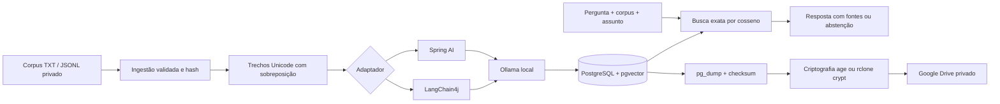

# Suntinus RAG Lab

Laboratório local de RAG em Java 21: PostgreSQL/pgvector, Ollama, Spring AI e LangChain4j. Dois adaptadores comparáveis compartilham ingestão, divisão de texto, SQL e regras de recuperação. O objetivo é estudar qualidade, rastreabilidade, isolamento de corpus e recuperação de backups.

**Código público, dados privados.** O repositório contém somente exemplos fictícios. Conversas pessoais, vetores, dumps, credenciais e chaves ficam fora do Git. Não é uma plataforma multiusuário nem uma API pronta para exposição pública.

## Arquitetura



## Requisitos e versões

- Java 21, PowerShell 7 e Docker Desktop com containers Linux.
- Maven Wrapper 3.9.11 com SHA-256; Spring Boot 3.5.16; Spring AI 1.1.8; LangChain4j 1.23.0.
- PostgreSQL 17 com pgvector 0.8.1; Ollama 0.40.15.
- Embeddings: `bge-m3:latest`, 1.024 dimensões, escolhido pelo suporte multilíngue. O digest real é registrado e conferido no início da aplicação.
- Geração: `qwen2.5:1.5b`, temperatura 0, até 512 tokens de saída. É um baseline leve, não garantia de qualidade. CPU funciona; GPU NVIDIA é opcional.

Versões de bibliotecas verificadas no Maven Central e testadas em conjunto. Não significa que sejam as únicas linhas atuais. Ao atualizar modelo, guardar o novo digest, reiniciar e reindexar; vetores de espaços diferentes não são misturados.

## Executar no Windows

```powershell
.\scripts\init-local.ps1
docker compose up -d postgres ollama
# Opcional, com NVIDIA configurada no Docker:
# docker compose -f compose.yaml -f compose.gpu.yaml up -d ollama
.\scripts\pull-models.ps1
.\mvnw.cmd verify
.\scripts\run.ps1
```

API: `http://127.0.0.1:8110`; PostgreSQL: `127.0.0.1:55438`; Ollama: `127.0.0.1:11438`. A API exige o token aleatório gerado em `.env`; somente `/actuator/health` é anônimo. Não imprimir ou versionar `.env`.

Alternativa com Java também no Docker, após baixar os modelos:

```powershell
docker compose --profile app up -d --build
```

Escolher execução Java local **ou** container para não disputar a porta. Para parar os serviços sem apagar os dados: `docker compose --profile app stop`.

## Demonstração e comparação

Em outro terminal, com a API funcionando:

```powershell
.\scripts\import-corpus.ps1 -CorpusPath examples\corpus.jsonl -Dataset demo-spring -Backend spring-ai
.\scripts\evaluate.ps1 -Dataset demo-spring
```

A avaliação usa os mesmos documentos para ambos os adaptadores, exige as fontes esperadas e testa abstenção em corpus vazio. Ela informa respostas, latência e abstenção; verificar manualmente se cada afirmação é sustentada. A presença de uma citação válida não comprova correção semântica.

Endpoints: `POST /api/{spring-ai|langchain4j}/documents`, `/search` e `/query`; `GET /api/backends`. `search` devolve os trechos sem geração. Campos de consulta: `dataset`, `question`, `topic` opcional, `topK` entre 1 e 10, `minScore` entre 0 e 1. O limiar inicial é um parâmetro experimental, não uma confiança calibrada.

```powershell
. .\scripts\load-env.ps1
$headers=@{Authorization="Bearer $env:RAG_API_TOKEN"}
$body=@{dataset='demo-spring';question='Dividir o pagamento é obrigatório?';topic='eventos';topK=3;minScore=0.3}|ConvertTo-Json
Invoke-RestMethod http://127.0.0.1:8110/api/spring-ai/query -Method Post -Headers $headers -ContentType 'application/json; charset=utf-8' -Body ([Text.Encoding]::UTF8.GetBytes($body))
```

## Usar as sessões unificadas

Mantenha o pacote pessoal **fora deste repositório**. O script lê o caminho informado e envia somente à API local autenticada:

```powershell
.\scripts\import-corpus.ps1 -CorpusPath 'C:\caminho-privado\corpus-rag.jsonl' -MainMemoryPath 'C:\caminho-privado\00-memoria-principal.txt' -Dataset codex-private
```

A importação é retomável: conteúdo e metadados idênticos no mesmo espaço de embeddings não são reprocessados. O SHA considera metadados, texto e versão de divisão. Alterações substituem todos os trechos daquele documento em uma transação; falhas preservam a versão anterior. A importação completa não é uma transação única: documentos concluídos permanecem se um seguinte falhar.

Cada trecho preserva sessão de origem, título, assunto, data, tipo de evidência e índice. `historical-extract` é relato histórico; `curated-context` é contexto revisado; `synthetic` é exemplo fictício. Datas e limites de evidência devem acompanhar as respostas. Pedidos não provam execução, nem testes locais provam publicação. Textos das sessões nunca são instruções operacionais para o laboratório.

## Backup e restauração

```powershell
.\scripts\backup.ps1
.\scripts\restore-drill.ps1 -BackupPath 'C:\caminho\backups\DATA-HORA'
```

`pg_dump -Fc` captura documentos, trechos, vetores, metadados e migrações em snapshot consistente. O manifesto registra SHA-256. O ensaio restaura em um banco novo `rag_restore_*`, preservando `rag`; mantém o banco de ensaio para inspeção. O backup não inclui pesos dos modelos nem a chave de recuperação.

Dois transportes opcionais para Drive:

1. **Arquivo criptografado com age**, adequado a upload manual ou pelo conector Google Drive: instalar [age](https://github.com/FiloSottile/age/releases), executar `scripts/seal-backup.ps1 -BackupPath ...` e enviar apenas o `.zip.age`. A chave fica em `private/backup-key.txt`. Guardar cópia separada em local seguro; perdê-la impede restauração. `scripts/unseal-backup.ps1` descriptografa em diretório novo, antes do ensaio.
2. **rclone crypt**, adequado a rotina local: instalar [rclone](https://rclone.org/install/), configurar `drive:` com OAuth e envolver o destino em `rag-crypt:`. Executar `scripts/backup.ps1 -CryptRemote 'rag-crypt:'`. O script exige tipo `crypt`, copia sem remover backups antigos e executa `cryptcheck`. Guardar credenciais e chaves fora do Git. Não há agendamento automático nem política de retenção destrutiva.

Backup local é texto e vetores privados; criptografia é aplicada antes do upload. Não basta o arquivo existir: fazer ensaio de restauração e conservar a chave separadamente.

## Boas práticas e limites

- Busca exata com filtros antes do top-k: baseline correto para o acervo pequeno. HNSW fica como experimento posterior com medição de recall filtrado.
- Divisão por pontos Unicode: 1.200 caracteres, sobreposição de 160; não é divisão por tokens. Lotes de até 16 para embeddings.
- Chamadas ao modelo antes da transação de escrita, bloqueio por documento, atualização atômica e SQL parametrizado.
- Token de API, portas somente em loopback, diretórios privados ignorados, container Java sem root, sem logs de conteúdo de prompts.
- Abstenção se não houver fontes. Se faltarem referências válidas, uma única tentativa de correção é permitida (no máximo duas gerações por pergunta); se ainda falhar, abstém. Essa checagem não demonstra alinhamento semântico entre resposta e fonte.
- Não há execução de ferramentas pelo LLM. Avisos no prompt mitigam instruções em documentos, mas não são prova de resistência universal a prompt injection.
- `dataset` separa corpora, não usuários. A API tem um único titular/token. Não usar como autorização multi-tenant.
- O usuário do banco também executa migrações; separar papéis de migração e aplicação é um exercício futuro antes de produção.
- Não há re-ranking, busca híbrida, filas duráveis, redaction perfeita ou garantia de não alucinação. Adicionar somente com casos de avaliação e comparação ao baseline.
- Próximo experimento de geração: modelo leve → validação de citações/evidência → modelo robusto local, com orçamento e limite de tentativas; não ativar fallback silencioso para serviço externo.

## Fontes oficiais

- [Spring AI](https://docs.spring.io/spring-ai/reference/) e [integração pgvector](https://docs.spring.io/spring-ai/reference/api/vectordbs/pgvector.html).
- [LangChain4j/Ollama](https://docs.langchain4j.dev/integrations/language-models/ollama/).
- [pgvector](https://github.com/pgvector/pgvector).
- [BGE-M3 no Ollama](https://ollama.com/library/bge-m3) e [Qwen2.5 1.5B](https://ollama.com/library/qwen2.5:1.5b).
- [PostgreSQL pg_dump](https://www.postgresql.org/docs/17/app-pgdump.html).
- [rclone Drive](https://rclone.org/drive/), [rclone crypt](https://rclone.org/crypt/) e [age](https://github.com/FiloSottile/age).

Licença MIT para o código original deste laboratório. Dados privados e licenças de modelos/dependências são separados.
